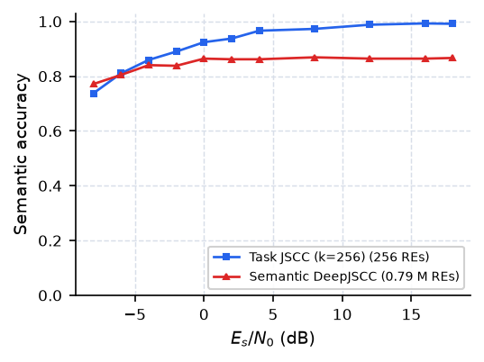
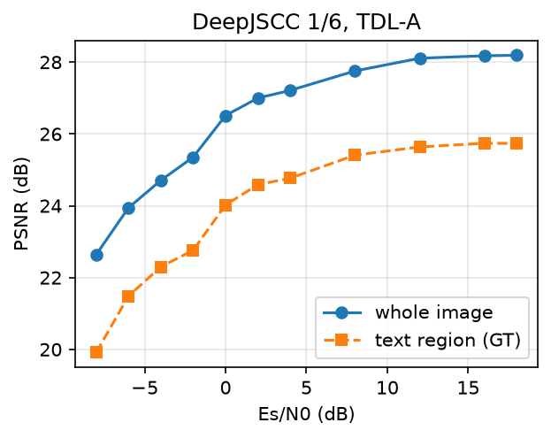

# STAR DeepJSCC Baselines

Learned baselines for **STAR: Semantic-Criticality Tiered Allocation of Radio Resources via Zero-Shot
Learning** (Albert Shaju and Christo Kurisummoottil Thomas, Worcester Polytechnic Institute; submitted to
IEEE ICC 2027).

STAR delivers the whole image to a remote control center and protects only its task-causal pixels, chosen
zero-shot by a frozen vision-language model. This repository contains the **trained, task-specific
alternatives** it is compared with: three DeepJSCC variants that send complex symbols straight onto the OFDM
resource elements (REs) of the **same 5G NR link** as STAR.

| Baseline | File | Receiver gets | REs per image |
|---|---|---|---|
| Reconstruction DeepJSCC | `djscc_baseline.py`, `train_djscc.py` | lossy image | 0.79 M |
| Task-oriented DeepJSCC | `task_djscc.py` | 7 answers, no image | 256 |
| Semantic-aware (hybrid) DeepJSCC | `hybrid_djscc.py` | lossy image **and** 7 answers | 0.79 M |

No VLM or LLM is used anywhere: the task-oriented and hybrid models answer the seven factory-monitoring
questions with trained classification heads, so semantic accuracy (S-Acc) is a classification accuracy.

## Channel (identical for all baselines and for STAR)

Sionna 2.0 (PyTorch): 30 kHz subcarrier spacing, 14 OFDM symbols × 128 subcarriers (1792 data REs per slot),
3.5 GHz, 3GPP TDL-A with 100 ns delay spread drawn independently per slot, perfect CSI, LMMSE equalization,
fixed $E_s/N_0$ with $E_s = 1$ per complex symbol. The encoder output is power-normalized per image and mapped
directly onto the REs (`SionnaLink` in `djscc_baseline.py`). The link is differentiable, so all models are
trained **through** it, with $E_s/N_0 \sim \mathcal U[-8, 18]$ dB drawn at every step.

## Models

**Reconstruction DeepJSCC** (Bourtsoulatze et al. style, 2.58 M parameters). Encoder: Conv 5×5/2 (3→128),
Conv 5×5/2, 2 × Conv 5×5, Conv 5×5 (128→16), PReLU. The 16 × H/4 × W/4 latent is read as complex pairs:
bandwidth ratio 1/6. Decoder: mirror with two transposed convolutions and a sigmoid. MSE loss, Adam 1e-4,
256 × 256 crops, batch 16, held-out factory panels 300–499. The released checkpoint is at step 5,000.

**Task-oriented DeepJSCC** (11.07 M parameters). Input downsampled by 2. Encoder: 5 stages of
[Conv 3×3/2, BN, ReLU, Conv 3×3, BN, ReLU] (64, 64, 128, 128, 256 channels), average pooling to 6 × 10, linear
layer to $k = 256$ complex symbols. Receiver: MLP (512 → 1024 → 1024) and seven linear heads with 3, 41, 56, 2,
6, 2, 2 classes. Sum of cross-entropies, AdamW 1e-3, warm-up + cosine, batch 16, 20,000 steps. Optional
`--digits` reads pressure and temperature digit by digit (not used for the released checkpoint).

**Semantic-aware DeepJSCC** (12.18 M parameters). The reconstruction DeepJSCC above, frozen, delivers the
image; a CNN on the **received** latent (4 stages with GroupNorm, 64–128 channels, pooling to 6 × 10,
MLP 1024 → 1024) answers the seven tasks (pressure and temperature digit by digit). Heads trained with
cross-entropy, AdamW 1e-3, batch 16, full resolution, 10,000 steps (`--freeze_jscc`). Joint fine-tuning of
image and answers is supported but was not used for the released results.

Training images for the task heads are rendered on the fly from a seed that never produces a test image;
evaluation uses the paper's 60 factory test images (20 per event, `SEED_RUN = 20240612`, panels 0–299).

## Results (factory-monitoring dataset, 60 test images)

S-Acc (mean over the seven tasks of Table I of the paper):

| $E_s/N_0$ (dB) | −8 | −4 | 0 | 4 | 8 | 12 | 18 |
|---|---|---|---|---|---|---|---|
| Task-oriented DeepJSCC (256 REs) | 0.74 | 0.86 | 0.92 | 0.97 | 0.97 | 0.99 | 0.99 |
| Semantic-aware DeepJSCC (0.79 M REs) | 0.77 | 0.84 | 0.86 | 0.86 | 0.87 | 0.86 | 0.87 |

The hybrid reads status, pressure, power, room, fire and technician (1.00 at 18 dB) but not the temperature
(≈ 0.07), which caps its S-Acc at 0.87. Its image reaches 28.2 dB PSNR and 25.8 dB on the ground-truth text
regions at 18 dB. The task-oriented model degrades at low SNR, first on the numeric readings.
Full per-task numbers are in `results/`, training logs in `logs/`, figures in `figs/`.

<p align="center"> </p>

## Setup

```bash
git clone https://github.com/christokt/STAR-DeepJSCC-Baselines.git
cd STAR-DeepJSCC-Baselines
pip install -r requirements.txt        # PyTorch with CUDA: install it first for your platform
```

**Dataset.** The factory-monitoring generator is part of the STAR repository. Copy its
`factory_dataset/` folder (generator and `annotations.json`) and its `Scene_template/` folder (the three scene
templates) into this folder, then render the images:

```bash
python factory_dataset/generate_factory_dataset.py --n 500 --seed 2027   # ~1 GB, factory_dataset/images/
```

Seed 2027 reproduces the ground truth of the released dataset exactly.

## Run

All commands run from the repository root. Every training script saves a checkpoint periodically and
accepts `--resume`; checkpoints in `checkpoints/` contain weights only.

```bash
# Reconstruction DeepJSCC (ratio 1/6)
python train_djscc.py --root . --factory --c 16 --out checkpoints/djscc_factory_c16.pt

# Task-oriented DeepJSCC (k = 256 REs), then evaluate on the 60 test images
python task_djscc.py train --k 256 --steps 20000 --out checkpoints/task_k256.pt
python task_djscc.py eval  --ckpt checkpoints/task_k256.pt --out results/task_k256.json

# Semantic-aware DeepJSCC: heads on the frozen reconstruction model, then evaluate
python hybrid_djscc.py train --init checkpoints/djscc_factory_c16.pt --freeze_jscc --batch 16 \
                             --steps 10000 --out checkpoints/hybrid_head.pt
python hybrid_djscc.py eval  --ckpt checkpoints/hybrid_head.pt --out results/hybrid_head.json

# Figures (add --star base_runs_final.pkl to overlay STAR from the STAR notebooks)
python plot_baselines.py --run "Task JSCC=results/task_k256.json" \
                         --run "Semantic DeepJSCC=results/hybrid_head.json" --out figs/baselines
```

To evaluate the released models without training, run only the `eval` and plotting commands.

Approximate speed on a single Colab GPU: 0.38 s/step (reconstruction), 0.61 s/step (task-oriented),
1.8 s/step (hybrid heads, full resolution).

**Google Colab.** `pip install sionna==2.0.1` upgrades NumPy inside a running session; restart the session
(Runtime → Restart session) before importing the modules in the notebook. Commands started with `!python`
are unaffected.

## Requirements

Python ≥ 3.11, PyTorch ≥ 2.4 (CUDA recommended), Sionna 2.0.1, NumPy, Pillow, Matplotlib.
